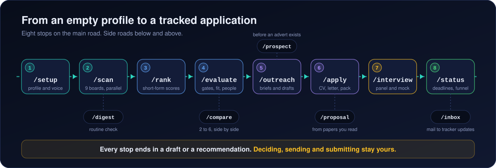
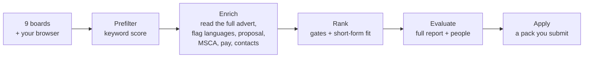
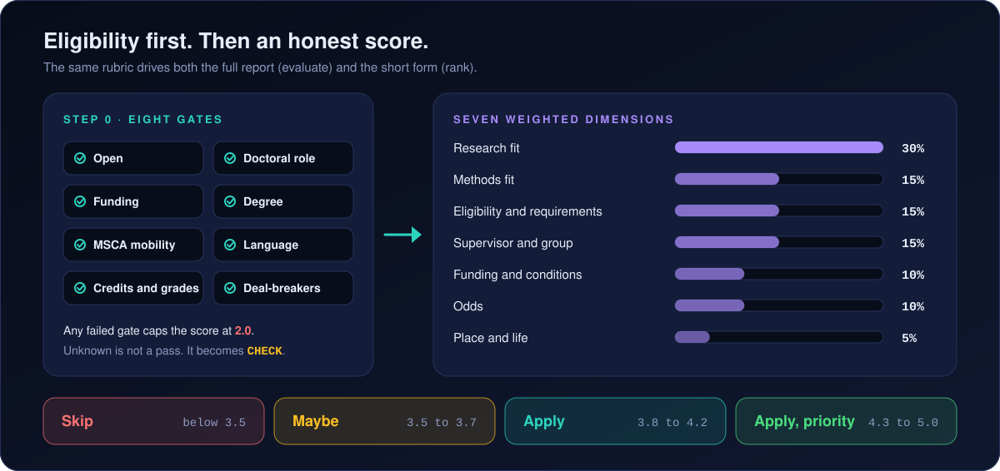

<p align="center">
  
</p>

<p align="center">
  
  
  
  
  
  
</p>

<p align="center">
  <a href="#quick-start"><b>Quick start</b></a> &nbsp;·&nbsp;
  <a href="#the-route"><b>The route</b></a> &nbsp;·&nbsp;
  <a href="#eligibility-first-then-an-honest-score"><b>How it scores</b></a> &nbsp;·&nbsp;
  <a href="#what-it-will-not-do"><b>What it won't do</b></a> &nbsp;·&nbsp;
  <a href="#boards"><b>Boards</b></a> &nbsp;·&nbsp;
  <a href="#how-it-compares"><b>Compared</b></a> &nbsp;·&nbsp;
  <a href="#faq"><b>FAQ</b></a>
</p>

> Independent open-source project. Not affiliated with Anthropic, EURAXESS, or any job board or university it reads.

**phd-hunter turns an AI coding assistant into a research assistant for the European doctoral job market.** It finds funded PhD positions, checks whether *you* are eligible before it scores anything, researches the supervisor and the group, drafts your application in your own voice, and keeps track of every deadline. You read everything. You press submit.

<table align="center">
  <tr>
    <td align="center"><b>13</b><br><sub>commands</sub></td>
    <td align="center"><b>9 + 1</b><br><sub>boards: 9 by script,<br>1 through your browser</sub></td>
    <td align="center"><b>8</b><br><sub>eligibility gates<br>before any score</sub></td>
    <td align="center"><b>0</b><br><sub>dependencies beyond<br>Python and curl</sub></td>
  </tr>
</table>

<p align="center">
  
</p>

<p align="center"><sub>An illustration with a fictional candidate and a fictional position. A real report has the same shape: <a href="#what-an-evaluation-contains">sections A to H</a>.</sub></p>

## Why a separate tool for PhDs

A PhD advert is not a job advert. The tool is built around the differences.

| | Industry job | Funded PhD | What phd-hunter does |
|---|---|---|---|
| **Who you apply to** | A company or a team | A named supervisor and a project | Reads the group page and the supervisor's recent papers; pulls their publication record from OpenAlex |
| **What decides eligibility** | Skills, visa | Degree field, credits, grades, language, funder rules, the Marie Curie mobility rule | Runs eight gates against your profile before it scores |
| **Documents** | CV and cover letter | Academic CV, motivation letter, often a research proposal, referee letters | Drafts all of them, plus a note to your referees |
| **Before you apply** | Nothing | Writing to the group first is normal, and many funded places go to people who did | `outreach` and `prospect` find the right person and the newly funded projects |
| **Where adverts live** | Company sites, ATS platforms | EURAXESS, national boards, university portals | Nine scripted boards, plus a browser collector for the ones that need one |

## What you get

| Step | Command | Result |
|---|---|---|
| Set up | `/phd-hunter setup` | Your profile, master CV, writing voice and search settings, built from your own CVs, letters and thesis |
| Find | `/phd-hunter scan` | New positions from nine boards in parallel. Each promising advert is then read in full and flagged for required languages, proposal and test requirements, MSCA funding, pay and contacts |
| Triage | `/phd-hunter rank` | Short-form scores for the best unscored postings: Apply now, Apply, Maybe, Blocked by a gate |
| Decide | `/phd-hunter evaluate <url or id>` | A full report: gates, a 1 to 5 fit score on seven dimensions, requirement-by-requirement match, supervisor and group research, conditions, strategy |
| | `/phd-hunter compare <ids>` | Two to six positions side by side, with a recommendation |
| Reach out | `/phd-hunter prospect <topic>` | Who in Europe publishes on a topic (OpenAlex) and which EU projects on it were just funded (CORDIS): a shortlist of groups to write to before an advert exists |
| | `/phd-hunter outreach <id, name or topic>` | Verified briefs on the people and short drafts in your voice, with a follow-up and a contact log |
| Apply | `/phd-hunter apply <id>` | A pack: tailored CV, letter, form answers, document checklist, referee note, reviewed against your CV and the advert, with .docx export |
| | `/phd-hunter proposal <id>` | A research proposal or project outline built from papers that were actually opened, after you pick the idea |
| Prepare | `/phd-hunter interview <tid>` | Panel research, likely questions with outlines from your own material, a mock interview |
| Track | `/phd-hunter inbox` | Saved or exported replies become proposed tracker updates; approved outreach becomes an unsent `.eml` you send yourself |
| | `/phd-hunter status` | Deadlines, follow-ups, a still-open check, funnel and answer rates, rejection patterns, dashboard, calendar file |
| | `/phd-hunter digest` | The routine check: what is new, what is due, which board broke |

Every mode also has a short form (`/scan`, `/evaluate`, and so on). **Paste an advert or a URL with no command and it runs `evaluate`.**

## Quick start

You need [Claude Code](https://claude.com/claude-code) (or another agent CLI that reads `AGENTS.md`), Python 3.9+ and `curl`. Optional: `pip install pypdf python-docx` to read PDFs during setup and export drafts to Word.

> [!IMPORTANT]
> **Keep your own search private.** Your personal folders are git-ignored, so a normal clone never uploads them. If you want your own remote, make it a private repository (a fork of a public repo is public) and keep this one as `upstream`: `git remote rename origin upstream`.

**1. Get it.**

```bash
git clone https://github.com/RoyIshan/phd-hunter.git
cd phd-hunter
```

**2. Add your documents.** Put your CVs, letters you wrote, thesis or summary and transcripts in `documents/`. More material gives a better profile.

**3. Start your assistant and run setup.**

```bash
claude
```

```
/phd-hunter setup
```

Setup reads your documents and writes four things: `profile/profile.yml` (facts only; anything unknown stays `CONFIRM` and is asked about once), `profile/cv.md` (your master CV, the only source of facts for anything drafted), `profile/voice.md` (how you write, taken only from text you wrote) and `config/search.json` (queries, keyword weights, languages, countries). It then runs a test scan and asks whether the top results look right.

**4. Hunt.**

```
/phd-hunter scan
```

Check the installation at any time with `python3 scripts/doctor.py --online`. It lists what is set up and what is broken, including any board whose page layout changed.

## The route

<p align="center">
  
</p>

How a posting travels from a board to a pack you submit:



The prefilter is a keyword score. It decides what gets read, not what you apply for. The fit score comes from `rank` and `evaluate`.

## Eligibility first, then an honest score

<p align="center">
  
</p>

Every evaluation starts by running the gates in [`reference/rubric.md`](reference/rubric.md) against your `profile.yml`. Any failure caps the total at 2.0, and the verdict names the gate and quotes the advert line it rests on.

| Gate | Fails when |
|---|---|
| Open | The deadline has passed, the advert is withdrawn or the position is filled |
| Doctoral role | It is a postdoc, professor or technician post, or one your profile lists as not wanted |
| Funding | Self-funded with no stipend when you want funded only, or restricted to a nationality, residency or fee status you do not hold |
| Degree | It needs a degree field yours cannot reasonably satisfy |
| MSCA mobility | An MSCA Doctoral Network hosted in a country where you lived more than 12 of the last 36 months |
| Language | A working language outside the ones you speak at about B2 or better |
| Credits and grades | A country or programme rule on master's length, credits, thesis size or minimum grade is not met |
| Deal-breakers | Anything you listed in `targets.deal_breakers` |

**Unknown is not a pass.** An unknown is marked `CHECK`, the report says who can answer it (you, or the advert's contact person), and the score is not capped for it.

Then seven dimensions, each scored 1 to 5 with one line of evidence:

| Dimension | Weight |
|---|---|
| Research fit | 30% |
| Methods fit | 15% |
| Eligibility and requirements | 15% |
| Supervisor and group | 15% |
| Funding and conditions | 10% |
| Odds | 10% |
| Place and life | 5% |

Set `rubric_weights` in your profile to use your own weights; the report says so when you do. In the short form (`rank`), the supervisor dimension stays a neutral 3 unless the supervisor's page was read.

| Total | Verdict |
|---|---|
| 4.3 to 5.0 | **Apply, priority.** Write to the supervisor first if time allows |
| 3.8 to 4.2 | **Apply.** Tailor carefully and address the main gap in the letter |
| 3.5 to 3.7 | **Maybe.** Only if the pack is cheap to produce or outreach gets a warm reply |
| Below 3.5 | **Skip.** The report says which dimension sank it. You can override |

<a id="what-an-evaluation-contains"></a>

<details>
<summary><b>What an evaluation contains (sections A to H)</b></summary>

```
# <Position> — <Institution>, <Country>
Score X.X / 5 — <verdict band> · Deadline <date> (<n> days) · <url>

## A. The position        what, where, funding, duration, start, contact person
## B. Gates               gate, verdict, the advert line it rests on
## C. Fit                 dimension, weight, score, evidence
## D. Requirement match   each stated requirement: met, partly or gap, with evidence from your CV
## E. People and group    supervisors, recent relevant papers with links, group activity
## F. Conditions          contract, pay (source, or labelled "estimate"), teaching, country notes
## G. Strategy            strongest reason in, most likely reason out, angle for the letter
## H. Documents required  checklist: have, adapt or write new, with effort
## Sources                every page read, and what was not read
```

Every evaluation also names what would change the score (a reply from the supervisor, a clarified requirement) and what could not be verified.

</details>

## What it will not do

These are the promises. The right-hand column says how each one is held, because a rule an assistant is asked to follow is weaker than a check in code.

| It will not | How that is held |
|---|---|
| **Send or submit anything** | In code: there is no mail-sending or form-posting code anywhere. Drafts are unsent `.eml` files (`mail.py`) you open and send yourself. Reading mail is read-only; an attached mail connector may create a draft only when you ask for one, and never sends |
| **Invent a fact** | In code and by rule: `scripts/verify.py` flags every number, name, language and claim in a draft that cannot be traced to `profile/cv.md`, and exits with an error when it finds any. A flag is a question, not a verdict, so a person still reads the flagged lines |
| **Cite a person or paper it has not opened** | By rule: the modes require the page to be read in the session and the link recorded. Otherwise the draft carries a marked `[CHECK: ...]` placeholder |
| **Obey instructions hidden in an advert** | By rule: adverts, emails and your own documents are treated as data. `fetch.py` reports how many hidden-style blocks a page has but does not strip them |
| **Push you to apply below 3.5** | By rubric: it says skip and names the dimension. You can override |
| **Get around bot checks or logins** | In code: parsers are plain, paced `curl` requests with no login code. By rule: if a board shows a check, the assistant asks you to pass it or skips the board |
| **Phone home** | In code: no telemetry and no backend. Your documents go from your machine to the AI provider you use, and nowhere else |
| **Leak your data into git** | `.gitignore` covers every personal folder, `doctor.py` checks it, and a unit test fails if a personal file is ever tracked |

Heuristics are pointers, never evidence. A flag such as `gate-language-dutch` means "this advert seems to demand Dutch", and a lead from OpenAlex means "check this person". Neither decides a verdict.

## Boards

| Board | Covers | How |
|---|---|---|
| EURAXESS | All of Europe | script, by research field |
| AcademicTransfer | Netherlands | script |
| jobs.ac.uk | United Kingdom | script |
| Jobbnorge | Norway | public API |
| academics.com | Germany, Austria, Switzerland | script |
| ETH Zürich, KTH, TU Munich, Aalto | university portals | script |
| Academic Positions | Europe | in your own browser, through a collector script |
| OpenAlex, CORDIS | people and funded projects | public APIs |

Where no parser exists yet, `scan` falls back to read-only web search of university vacancy pages, funder calls and field mailing lists. Adding a board is one function: [docs/ADDING_A_BOARD.md](docs/ADDING_A_BOARD.md).

<details>
<summary><b>Limits worth knowing</b></summary>

- **Coverage is uneven.** EURAXESS has no keyword search for scripts, so the newest offers per research field are walked and scored locally. Jobbnorge and Academic Positions adverts cannot be read in full by script.
- **Boards change their pages.** The scan warns when a board that used to return results returns none, and `doctor.py` repeats the warning.
- **Not scanned:** FindAPhD, DAAD, PhDportal and scholarshipdb. They block automated access, including in a browser session.
- **Country figures** in [`reference/countries.md`](reference/countries.md) are orientation, not quotes. Pay and conditions are estimates unless read from the advert or an official table in the session.
- **Europe only**, and it reads English-language adverts best.
- **It can be wrong.** Read every document before you send it, and read the papers a proposal cites.

</details>

## Two dashboards, a calendar and a batch mode

- **Offline HTML dashboard.** `python3 scripts/dashboard.py` writes a single `dashboard.html` (pipeline board, deadlines, sortable positions) that works offline and follows your light or dark theme.
- **Terminal dashboard.** `python3 scripts/tui.py` is the same pipeline in the terminal with three views (positions, applications, due). Filter, sort, read details, open adverts, track or dismiss. `--plain` prints it and exits.
- **Calendar file.** `python3 scripts/ops.py ics` writes `data/deadlines.ics` for your calendar app.
- **Parallel batch.** `python3 scripts/batch.py --top 8 --workers 3` runs several headless agent workers at once, one position each, and merges their scores when all are done. Run it with `--dry-run` first: every worker spends tokens on your own account, and `--cli codex|gemini|opencode` picks another agent.

## Other agent CLIs

The modes are plain Markdown. The repository ships the instruction files other tools look for, all generated from one source by `scripts/sync_agents.py`.

| Tool | File |
|---|---|
| Claude Code | `.claude/commands/` (short forms such as `/scan`) and `.claude/skills/` |
| Codex, OpenCode, Cursor and Copilot agents, and others | `AGENTS.md` |
| Gemini CLI | `GEMINI.md` and `.gemini/commands/phd-hunter.toml` |
| OpenCode | `.opencode/commands/phd-hunter.md` |
| Cursor | `.cursor/rules/phd-hunter.mdc` |
| GitHub Copilot | `.github/copilot-instructions.md` |
| Agents that load skills from `.agents/` | `.agents/skills/phd-hunter/SKILL.md` |

Only Claude Code has been tested end to end. Reports from other CLIs are welcome.

<details>
<summary><b>Without an assistant: the scripts on their own</b></summary>

```bash
python3 scripts/scan.py                          # sweep the boards
python3 scripts/enrich.py                        # read the full adverts, set signals
python3 scripts/ops.py postings --min 25         # list by prefilter score
python3 scripts/prospect.py scholars "topic"     # who publishes on it (OpenAlex)
python3 scripts/prospect.py projects "topic"     # what was just funded (CORDIS)
python3 scripts/alive.py                         # are tracked positions still open?
python3 scripts/verify.py output/<pack>/         # flag anything not in your CV
python3 scripts/ops.py stats                     # funnel and answer rates
python3 scripts/ops.py due --days 21             # deadlines and next actions
python3 scripts/dashboard.py                     # offline HTML dashboard
python3 scripts/tui.py                           # terminal dashboard
python3 scripts/batch.py --dry-run               # what a batch would do
```

</details>

## Your data stays yours

| Folder | Holds | Committed? |
|---|---|---|
| `profile/` | Your facts, master CV, voice | never |
| `config/search.json` | Your themes, languages, countries | never |
| `data/`, `reports/`, `output/`, `documents/`, `dashboard.html` | Postings, tracker, contacts, evaluations, drafts, source documents | never |
| `modes/`, `reference/`, `templates/`, `scripts/`, `docs/` | The tool | yes |

`.gitignore` enforces this, `scripts/doctor.py` checks it, and the unit test suite fails if a personal file is tracked. If you fork to contribute, work on a branch with no personal data.

<details>
<summary><b>Project layout</b></summary>

```
phd-hunter/
├── CLAUDE.md             # Project rules and layout (generated files below derive from it)
├── AGENTS.md  GEMINI.md  # Instruction files for other agent CLIs (generated)
├── modes/                # What each command does, in plain Markdown
├── reference/            # Fit rubric, country notes, EURAXESS field IDs
├── templates/            # Example profile, CV, voice and search config for a fictional candidate
├── scripts/              # The tools: scan, enrich, ops, prospect, verify, dashboards, batch, mail
├── docs/                 # Adding a board; the README artwork and the script that draws it
├── tests/                # Offline unit tests
├── profile/              # Your facts, CV and voice          (git-ignored)
├── config/search.json    # Your search settings              (git-ignored)
├── documents/            # Your source documents             (git-ignored)
├── data/                 # Postings, tracker, contacts, ads  (git-ignored)
├── reports/              # Evaluations, rankings, briefs     (git-ignored)
└── output/               # Application packs                 (git-ignored)
```

</details>

## How it compares

phd-hunter was inspired by [career-ops](https://github.com/career-ops-hq/career-ops) and [ai-job-search](https://github.com/ai-job-search-dev/ai-job-search), which do this for industry jobs. Both are far more mature and have far larger communities. If you are looking for an industry job, use one of them. For funded doctoral positions in Europe, this is what a general job tool does not do.

| | **phd-hunter** | **career-ops** | **ai-job-search** |
|---|---|---|---|
| Built for | Funded PhDs in Europe | Industry roles, mostly tech | Industry roles, any country |
| Sources | EURAXESS by research field, academic boards, university portals | 180+ preset companies, ATS feeds, 55+ board modules | None shipped; board skills you copy in |
| Eligibility | Eight PhD gates: degree, credits, grades, language, MSCA mobility, funding rules | Level, pay, work-authorisation signal | Your own deal-breakers, plus a language gate |
| People | Supervisor and group research, OpenAlex publication records | Hiring manager and recruiter discovery | Interviewer research |
| Before an advert exists | Who publishes on a topic (OpenAlex); newly funded EU projects (CORDIS) | Funded-company discovery, `gambit` | Not in its README |
| Documents | Academic CV, motivation letter, research proposal, referee note; Markdown and .docx | Designed ATS PDFs, cover letters, LaTeX export | LaTeX CV and letter, compiled and checked |
| Fact check | `verify.py` flags anything not in your CV | A check in code (its own FAQ says it cannot judge every rewording) | By instruction |
| Hostile adverts | By instruction | Not in its README | Code-level posting guard |
| Review of drafts | A checklist run by the same agent, plus `verify.py` | An ATS check and a job-title check | A separate fresh-context reviewer agent |
| Live form filling | No | Yes, stops before Submit | Not in its README |
| Mail | Saved or exported mail in, unsent `.eml` out; a connector is read-only unless you ask for a draft | Opt-in Gmail plugin, `reply-watch`, follow-up cadence | `/gmail-sync`, follow-up drafts |
| Tracking | CSV, `.ics` deadlines, offline HTML and terminal dashboards | Terminal dashboard, alpha web UI, funnel stats, `calibrate` | CSV, offline HTML report, Notion view |
| Batch | Parallel headless workers | Parallel headless workers | Parallel scoring agents in `rank` |
| Install | Clone; Python and `curl` only | One `npx` command; plugin, Docker and Windows docs | Private copy; Python, Bun and a LaTeX install |
| AI CLIs | Claude Code tested; instruction files for Gemini, OpenCode, Cursor, Copilot and any `AGENTS.md` reader | About ten supported, including free and local models | Claude Code |

<sub>career-ops and ai-job-search columns are taken from their READMEs in November 2026. Check their repositories for the current state.</sub>

## FAQ

<details>
<summary><b>Does it apply for me?</b></summary>

No. It evaluates, ranks and drafts. You read the documents and you submit them. There is no code that posts to a portal or sends an email.

</details>

<details>
<summary><b>What does it cost?</b></summary>

The tool is free. The scripts (`scan`, `enrich`, `alive`, `verify`, `ops`, `prospect`) run locally. The assistant's reading, scoring and drafting uses your AI provider's tokens, on whatever plan you already have. Batch mode starts several workers at once and says so before it does.

</details>

<details>
<summary><b>Can a draft invent things about me?</b></summary>

The rule is that everything written for you must be in your master CV, and `verify.py` flags numbers, names, languages and claims that are not. It checks traceability, not truth: it cannot judge every rewording. Read every document before you send it.

</details>

<details>
<summary><b>Does it work for postdocs or industry jobs?</b></summary>

No. The doctoral-role gate fails a postdoc, professor or technician post. For industry jobs use career-ops or ai-job-search.

</details>

<details>
<summary><b>Can it polish the wording of my drafts?</b></summary>

Yes. If you have a humanizer or editing skill installed in your assistant, the modes run drafts through it before showing them. None is bundled; install any one you trust. Drafts must still pass `verify.py`, and you read every word before it goes out.

</details>

<details>
<summary><b>Where does my data go?</b></summary>

Your profile, tracker and drafts are local files in git-ignored folders. Your documents are sent to the AI provider you chose, so that it can read them, and nowhere else. There is no telemetry and no backend.

</details>

<details>
<summary><b>A board returns nothing. What now?</b></summary>

The page layout probably changed. `scan` and `doctor.py --online` both say which board it is, and the parser is one function you can fix ([docs/ADDING_A_BOARD.md](docs/ADDING_A_BOARD.md)).

</details>

## Contributing

phd-hunter is small on purpose: Python standard library, plain Markdown instructions, no build step. Good first contributions:

- A parser for another board or university portal ([docs/ADDING_A_BOARD.md](docs/ADDING_A_BOARD.md))
- A fix when a board changes its page
- Corrections and sources for [`reference/countries.md`](reference/countries.md)
- More EURAXESS field IDs in `reference/euraxess-fields.json`
- Language patterns in `scripts/enrich.py`, with a test case
- Translations or field-specific variants of the files in `modes/`
- Reports from running it in an agent CLI other than Claude Code

Run the offline tests before you push. They also run in CI on Python 3.9 and 3.12.

```bash
python3 -m unittest discover tests
```

No personal data, ever, and nothing that logs in, posts, sends or gets around a bot check. Details in [CONTRIBUTING.md](CONTRIBUTING.md).

## Credits and licence

Inspired by [career-ops](https://github.com/career-ops-hq/career-ops) and [ai-job-search](https://github.com/ai-job-search-dev/ai-job-search). Data on people and projects comes from [OpenAlex](https://openalex.org) and [CORDIS](https://cordis.europa.eu).

### Forks, attribution and the name

Forks and pull requests are welcome. The code is [MIT](LICENSE) licensed: copy and change it freely, but keep the licence and copyright notice. The name **phd-hunter** and its artwork are reserved for this project: a modified copy needs its own name and a line saying it is based on this one. See [TRADEMARK.md](TRADEMARK.md). To cite the project, use [CITATION.cff](CITATION.cff) (GitHub shows a "Cite this repository" button).

<sub>phd-hunter drafts and recommends. Evaluations are recommendations, not truth, and country figures are orientation. You decide, and you are responsible for what you send.</sub>
